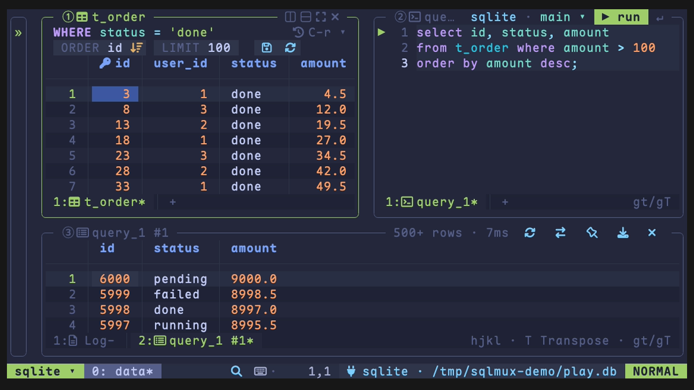
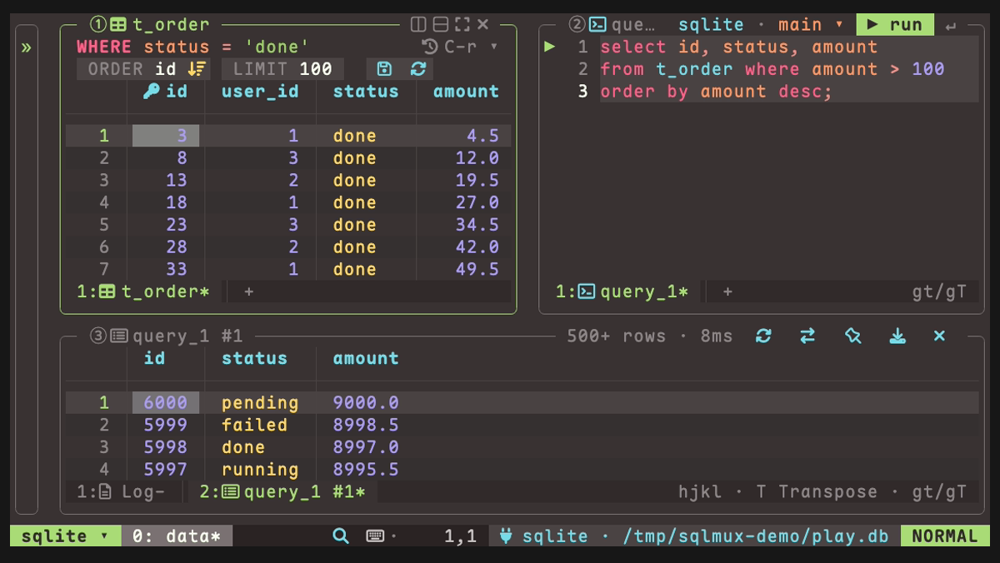

# Configuration

sqlmux reads four kinds of files from `$XDG_CONFIG_HOME/sqlmux`, which is `~/.config/sqlmux` when the variable is unset (macOS too). All of them are optional.

| File | Who writes it | What it holds |
|---|---|---|
| `config.toml` | you | options and the theme |
| `keymaps.toml` | you | key bindings and maps |
| `connections.toml` | you, and the connection form | connections |
| `themes/<name>.toml` | you | your own themes |
| `layouts/<name>.toml` | you, or *Save layout as…* | named layouts |

On Windows, without `XDG_*` variables, the configuration is in `%APPDATA%\sqlmux` and the state and data below are in `%LOCALAPPDATA%\sqlmux`.

sqlmux writes its own state under `$XDG_STATE_HOME/sqlmux` (`~/.local/state/sqlmux`: recent items, WHERE history and favorites, `last.toml`, the layout you quit from) and `$XDG_DATA_HOME/sqlmux` (`~/.local/share/sqlmux`: `queries/*.sql`, `history.jsonl` and `redis-index/`).

A key sqlmux does not know (a typo such as `readonly`) is reported in a toast at startup; a bad value stops the start with the file, the key and the values it takes.

## config.toml

Every option with its default. Only write the ones you change.

```toml
theme             = "tokyonight-storm" # built in: tokyonight-storm, ristretto; or a file in themes/
icons             = "nerd"             # nerd | ascii (no Nerd Font needed)
border            = "single"           # single | rounded | double | bold | hidden
border_focus_style = ""                # the focused pane's and overlays' lines, same values; "" follows border
default_connection = ""                # the connection --table, --sql and a start without last.toml use; "" = the first in connections.toml
language          = "en"               # en | zh
vim               = true               # false: query and WHERE are plain editors; the grid and tree also take PgUp / PgDn / Delete
timeoutlen        = 1000               # ms to wait for the next key of a sequence
result_height     = 0.4                # share of the window the result area starts with, between 0 and 1
tab_width         = 2                  # indent in queries, and for the formatter
keyword_case      = "lower"            # lower | upper | preserve, for formatting (gq)
formatprg         = ""                 # a command to format with instead of the built-in sql-formatter, e.g. "pg_format -"
autopairs         = true               # typing a bracket or quote adds its other half
confirm_dangerous = true               # ask before DELETE / UPDATE without WHERE, DROP, TRUNCATE, and saves that delete rows
clipboard         = ""                 # "unnamedplus": y, d, c, x and p in the editors use the system clipboard, as in nvim

[ui]
tips = true                            # a feature tip in the status bar

[tree]
width  = 32                            # sidebar width in columns, borders included
follow = false                         # true: opening or focusing the sidebar moves its cursor to the current tab's table

[grid]
full_width = 22                        # columns up to this width are never squeezed
order      = "asc"                     # asc | desc: the default sort of a table you open
transpose  = false                     # open tables transposed
preview_save = true                    # C-s shows the statements before running them (always on for production connections)

[query]
max_rows    = 500                      # rows a query keeps per page of a result
history_max = 1000                     # statements kept in history.jsonl
hints       = true                     # the line that says which column the value under the cursor goes in

[redis]
delimiter = ":"                        # splits key names into namespaces in the tree
scan_keys = 10000                      # keys a database scan reads before it stops (use / to filter)
load_all  = 5000                       # hashes, sets and sorted sets up to this length are read whole
index_keys = 100000                    # key names kept per database for fuzzy key completion and the palette
index_cache = true                     # save that index to disk, so completion is ready at once next time

[pane]
outer_nav = "off"                      # "auto": inside tmux, C-h / C-j / C-k / C-l at sqlmux's edge go to the next tmux pane
```

`border_focus_style` lets the focused pane stand out by its lines, not only its color: `border = "single"` with `border_focus_style = "bold"` draws the focused pane and the overlays in bold lines and the rest in thin ones. Unicode has no bold rounded corners, so with `border = "rounded"` and `border_focus_style = "bold"` the focused pane has square corners, and the corners change as the focus moves.

`default_connection` names the connection sqlmux uses when you don't give one: `--table`, `--sql`, and the default layout when there is no `last.toml` to restore. Without it, that is the first connection in `connections.toml`. A name that is not there is reported in a toast at startup, and the first connection is used.

`index_cache` keeps the key index of each Redis database in `$XDG_DATA_HOME/sqlmux/redis-index/<connection>/db<n>` (mode 0600, since key names can say a lot about your data). On the next start, the first key completion uses the saved index straight away while a fresh scan runs in the background; the list says "Updating the index" until the fresh one replaces it. With `index_cache = false` nothing is read or written, and files already there are left alone. See [Redis](redis.md#console).

### Moving between tmux and sqlmux panes

With `[pane] outer_nav = "auto"` and sqlmux running inside tmux, `pane.focus.left` / `down` / `up` / `right` (`C-h` / `C-j` / `C-k` / `C-l`) move between sqlmux's own panes as usual, and when there is no pane on that side (the focus is on the sidebar and you press `C-h`, say), the same key runs `tmux select-pane` and you land in the tmux pane next to sqlmux. Outside tmux, or with `outer_nav = "off"` (the default), nothing changes.

Getting back in is tmux's job: tmux has to pass `C-h` / `C-j` / `C-k` / `C-l` to the pane when sqlmux runs in it, as [vim-tmux-navigator](https://github.com/christoomey/vim-tmux-navigator) does for vim. Add `sqlmux` to its pattern. If you load vim-tmux-navigator with TPM, one line in `~/.tmux.conf`:

```tmux
set -g @vim_navigator_pattern '(\S+/)?g?\.?(view|l?n?vim?x?|fzf|sqlmux)(diff)?(-wrapped)?'
```

Without the plugin, these lines in `~/.tmux.conf` are its bindings with `sqlmux` added:

```tmux
vim_pattern='(\S+/)?g?\.?(view|l?n?vim?x?|fzf|sqlmux)(diff)?(-wrapped)?'
is_vim="ps -o state= -o comm= -t '#{pane_tty}' \
    | grep -iqE '^[^TXZ ]+ +${vim_pattern}$'"
bind-key -n 'C-h' if-shell "$is_vim" 'send-keys C-h'  'select-pane -L'
bind-key -n 'C-j' if-shell "$is_vim" 'send-keys C-j'  'select-pane -D'
bind-key -n 'C-k' if-shell "$is_vim" 'send-keys C-k'  'select-pane -U'
bind-key -n 'C-l' if-shell "$is_vim" 'send-keys C-l'  'select-pane -R'
```

Then `tmux source-file ~/.tmux.conf`. Only tmux is supported for now, not WezTerm or Zellij.

### Clipboard

By default the editors (query, WHERE, the value editor, the JSON view) keep `y`, `d` and `p` to themselves, as vim does; `"+y` and `"+p` reach the system clipboard. With `clipboard = "unnamedplus"`, as in nvim, every yank, delete and change without a register name also goes to the system clipboard, and `p` / `P` paste from it. A block you yanked comes back as a block. `"_` (the black hole) and `""` still leave the clipboard alone. Copying from a table (`yy`, `yl`) always goes to the system clipboard, whatever this says.

sqlmux uses `pbcopy` / `pbpaste`, `wl-copy` / `wl-paste`, `xclip` or `xsel`, whichever it finds (PowerShell on Windows), and otherwise falls back to the terminal's OSC 52 (over SSH, for instance). OSC 52 can write but usually not read, so with `unnamedplus` there `p` pastes what you last yanked in sqlmux.

## connections.toml

```toml
[[connection]]
name     = "local"                     # required, unique; no / or \, not starting with .
engine   = "postgres"                  # postgres | mysql | sqlite | mssql | redis
dsn      = "postgres://me@localhost:5432/app?sslmode=disable"
password_cmd = "security find-generic-password -s sqlmux-local -w"
read_only = false                      # refuse writes on this connection
production = false                     # warning color, confirm every write, read-only unless read_only = false is written
databases = ["app"]                    # postgres: the databases the tree lists; unset = all
schemas   = ["app.public"]             # the schemas listed and loaded: "db.schema" on postgres, the name on mysql; unset = all non-system ones
group     = "dev"                      # optional: a labelled section in the tree
ssh       = "me@bastion"               # optional: connect through this machine
```

DSN per engine:

| engine | dsn |
|---|---|
| `postgres` | `postgres://user@host:5432/db?sslmode=disable` (the tree lists the other databases on the server too) |
| `mysql` | `user@tcp(host:3306)/db` or `mysql://user@host:3306/db` |
| `sqlite` | a file path; `~` is expanded, `?mode=ro` and other query parameters pass through; a missing file is not created |
| `mssql` | `sqlserver://user@host:1433?database=app` (`mssql://` works too); driver options such as `encrypt` pass through. A server with a self-signed certificate, like the official Docker image, needs `&TrustServerCertificate=true` |
| `redis` | `redis://user@host:6379/0` or `rediss://…`; the number is the database. See [Redis](redis.md) |
| `exec` | no `dsn`: `dialect` and `command`, see [External commands](#external-commands-engine--exec) |

Where the password comes from, first one set wins:

| field | example | notes |
|---|---|---|
| `password_cmd` | `"security find-generic-password -s sqlmux-local -w"` | any command that prints it: `pass`, `op`, `bw`, `secret-tool` |
| `password_env` | `"APP_DB_PASSWORD"` | the name of an environment variable |
| `password` | `"secret"` | plain text; sqlmux does not warn or change the file's permissions |
| in the DSN / `~/.pgpass` | `postgres://u:p@…` | handled by the driver |

The connection form (`+` at the top of the sidebar, or *New connection…* in the palette) saves the password in the OS keychain (macOS Keychain, or `secret-tool` on Linux desktops) and writes the `password_cmd` that reads it back. It appends to this file and keeps your comments; *Manage connections…* edits and deletes entries the same way.

In WSL, on a server, or anywhere else without a keychain, keep the password in a file only you can read (`chmod 600 ~/.config/sqlmux/local.pw`) and write `password_cmd = "cat ~/.config/sqlmux/local.pw"`. One trailing newline is dropped.

`${VAR}` inside `dsn` or `password` is replaced from the environment, so `dsn = "${DATABASE_URL}"` works.

`databases` and `schemas` narrow a big server to what you use: databases not listed are not connected to, schemas not listed are not loaded (their tables don't show in the tree, the palette or completion). The database in the DSN is always included. *Pick databases…* / *Pick schemas…* in the tree's right-click menu (or the palette) edit them for you and keep the rest of the file.

`production = true` marks a connection whose data matters: its borders, status bar block and tab titles use the `production` theme color, every write asks first (table saves, write statements, Redis write commands, deletes and renames in the tree), and it is read-only unless `read_only = false` is written as well. See [Safety](../README.md#safety).

`ssh = "user@host"` runs `ssh -W host:port user@host` for each connection; the port, key and `ProxyJump` come from `~/.ssh/config`, and no local port is opened. ssh cannot ask for a password or passphrase here, so `ssh-add` the key first. It does not apply to SQLite or to connections given on the command line.

### External commands (`engine = "exec"`)

For a database you can only reach through a command-line tool, sqlmux can run every statement through that command instead of a driver. Such a connection is always read-only, and is written by hand (the connection form and manager don't list it).

```toml
[[connection]]
name    = "prod-pg"
engine  = "exec"
dialect = "postgres"                 # postgres | redis: which catalog, paging, quoting and completion to use
command = ["mytool", "query", "--json", "{sql}"]          # {sql} is replaced by one statement

[[connection]]
name    = "prod-cache"
engine  = "exec"
dialect = "redis"
command = ["mytool", "redis", "--json", "--", "{cmd}", "{args...}"]   # {cmd} the command, {args...} its arguments
```

The command runs once per statement (cancelling kills it) and prints JSON on stdout: for SQL, one item per statement with `columns` (ordered names), `rows` (an array per row; nested values are shown as JSON text), `n` (affected or total rows, optional), `err` (the error text, if any) and `truncated` (`true` when the command cut the rows short: sqlmux then pages through its own queries with `limit` / `offset`, and marks your own statements as truncated); for Redis, the reply itself. A non-zero exit makes its stderr the error. sqlmux checks the connection with `select current_database()` or `PING` when it connects.

## Command line

```sh
sqlmux                      # restore the layout you quit from (or the default one)
sqlmux local                # open the connection named local
sqlmux ./app.db             # open a SQLite file
sqlmux postgres://me@localhost/app   # or mysql://…, redis://…: a temporary connection, not saved anywhere
sqlmux --layout work        # open layouts/work.toml (or a path)
sqlmux local --table orders # open the table orders of local ([schema.]table; on Redis, a key)
sqlmux --table orders --where "user_id = 42"   # the default connection, with this WHERE already run
sqlmux local --sql "select status, count(*) from orders group by 1"   # run one statement, the result below it
sqlmux local --schema sales --table orders   # --schema picks the schema for --table and --sql
sqlmux keys                 # list every action and its keys
sqlmux keys --format toml   # a complete keymaps.toml to start from
sqlmux keys --check         # report conflicts in your keymaps.toml (exit 1 if any)
sqlmux --version
```

`--table`, `--where`, `--sql` and `--schema` go before or after the connection. Without a connection they use `default_connection`, or the first one in `connections.toml`. The table opens in the default layout, its WHERE goes into the table's history like one you typed, and quitting does not overwrite the layout `sqlmux` restores. `--where` needs `--table` and does not work on Redis; `--table` cannot go with `--layout`.

`--sql` opens a window with only the tree, a query holding the statement and the result below it, and runs the statement as `↵` in a query would (several statements run one after another). It is a query like any other: page, export, edit and run again. Read-only connections refuse writes and dangerous statements ask first, as in a query. The query is not saved as a file unless you change it (the statement is in `history.jsonl`), and quitting does not overwrite the layout `sqlmux` restores. On Redis, `--sql` takes a command: `sqlmux cache --sql "dbsize"`. `--sql` cannot go with `--table`, `--where` or `--layout`.

`--schema` is written as in the query title's dropdown: `[database.]schema` on PostgreSQL and SQL Server, the database on MySQL, the db number on Redis. Without it, the connection's own schema is used; a schema that does not exist is reported in a toast and the connection's own is used. With `--table`, a table name without a schema is looked up in it.

`DATABASE_URL` is used only when `connections.toml` has no connections and no argument is given. Press `C-c` twice to quit.

## keymaps.toml

The full list of actions and default keys is in [Keys](keys.md). `sqlmux keys --format toml` prints a complete `keymaps.toml`: the defaults as comments and your own changes as live lines, so it is a safe starting point. Keep only the lines you change.

```toml
[keys]
leader = "<C-a>"                 # the default is "<Space>"

[keys.normal]                    # NORMAL mode in any pane
"<C-w>v" = "pane.split.right"
"<C-w>s" = "pane.split.below"

[keys.grid]                      # only on a table
"x" = ""                         # "" unbinds the key

[map.normal]                     # a key -> a run of keys, like vim's noremap, in every pane
J = "5j"
K = "5k"

[map.query.normal]               # only in a query
L = "5l"
```

The `[keys.<scope>]` tables are the ones in [Keys](keys.md) (`normal`, `grid`, `tree`, `query`, `result`, `palette`, …). Maps go in `[map.normal]` / `[map.visual]` for every pane, or `[map.<pane>.normal]` / `[map.<pane>.visual]` with `query`, `grid` or `tree`. Run `sqlmux keys --check` after editing.

## Themes

Two themes are built in: `tokyonight-storm` (the default) and `ristretto`, a warm gray in Monokai Pro colors.

| `theme = "tokyonight-storm"` | `theme = "ristretto"` |
|---|---|
|  |  |

`theme = "<name>"` looks for `themes/<name>.toml` first, then a built-in theme, so a file of your own can take a built-in name. A theme file lists only the colors it changes, as `"#rrggbb"`; the rest come from `tokyonight-storm`. *Switch theme…* in the palette changes it while sqlmux runs.

```toml
# ~/.config/sqlmux/themes/warm.toml
pane_bg = "#393333"
focus   = "#a9dc76"
number  = "#ab9df2"
string  = "#ffd866"

[icon.table]                     # change an icon's glyph, its color, or both
text = "T"
fg   = "#fc9867"
```

Color tokens: `production` (production connections, defaults to `error`), `bg`, `pane_bg`, `gap` (the space between panes, defaults to `pane_bg`), `fg`, `fg_muted`, `dim`, `border`, `border_focus` (the focused pane's and overlays' borders, defaults to `focus`), `focus`, `warn`, `zoom`, `match`, `cursor`, `cursor_blur`, `select`, `row`, `row_alt`, `visual`, `selected`, `search`, `search_current`, `yank`, `edited_bg`, `error`, `error_bg`, `info`, `bar`, `sep`; SQL text: `keyword`, `sql_string`, `comment`, `sql_table`, `sql_column`, `sql_operator`; grid values by column type: `number`, `string`, `time`, `bool`, `json`, `pk`, `func`.

Icon names: `schema`, `table`, `view`, `column`, `key`, `index`, `func`, `sequence`, `query`, `result`, `log`, `conn`, `postgres`, `mysql`, `sqlite`, `redis`, `str`, `hash`, `list`, `set`, `zset`, `stream`, `json`, `window`, `pane`, `filter`, `search`, `keys`, `command`, `save`, `refresh`, `transpose`, `row_add`, `row_delete`, `auto_refresh`, `stop`, `sort_asc`, `sort_desc`, `lock`, `pin`, `export`, `close`, `star`, `history`, `zoom`, `unzoom`, `split_right`, `split_below`, `tag`, `host`, `port`, `user`, `database`, `advanced`, `link`, `group`; completion kinds: `keyword`, `value`, `snippet`; right-click menus: `open`, `edit`, `copy`, `trash`, `rename`, `hide` (the menu's *View as JSON* uses `json`). With `icons = "ascii"`, completion shows a letter per kind and menus show no icons, and an `[icon.<name>]` `text` that is not plain ASCII is ignored (its `fg` still applies), so a theme written with Nerd Font glyphs works without one.

## Layouts

sqlmux saves your sessions, windows, panes and tabs (with each table's WHERE, ORDER, LIMIT and page) to `last.toml` when you quit, and `sqlmux` with no argument restores them. *Save layout as…* in the palette writes `layouts/<name>.toml`; *Open layout* or `sqlmux --layout <name>` opens one. Results, running queries and unsaved edits are not saved.
